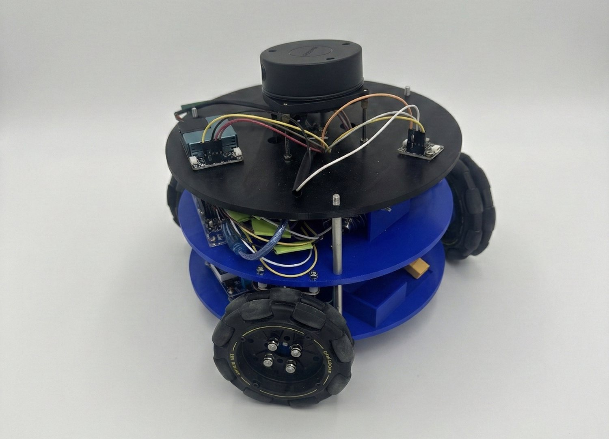

## About

Saeid Chahardoli is a Ph.D. student in Construction Management at **Louisiana State University (LSU)**, where he also completed an M.Sc. in Computer Science. His research bridges artificial intelligence and the physics of the built environment: he builds autonomous robots, deep-learning models and physics-based simulations that make the flows of air, energy and data inside buildings visible, measurable and controllable.

Before LSU, he earned an M.Sc. in Architectural Engineering from the **Iran University of Science and Technology**, where he modeled particle dispersion around buildings with CFD.

**Research interests:** indoor air quality, HVAC optimization, physics-informed machine learning, mobile robotic sensing, computational fluid dynamics.

## Research

**AI for indoor air quality and HVAC.** Reinforcement-learning (PPO) control policies that balance ventilation, thermal comfort and energy use against measured baselines.

**Physics-informed machine learning.** Fast surrogate models of indoor airflow distribution that combine Explainable Boosting Machines and deep learning (Transformers, RNNs) with CFD-grounded features.

**Autonomous mobile sensing.** A custom ROS 2 robot that drives itself through a room on LiDAR-SLAM, samples CO₂, PM₂.₅, temperature and humidity every two seconds, and fuses the readings into a room-wide pollutant map. A gradient-ascent search on that map located a smoke source to within 0.74 m, replacing a 24-point grid of fixed sensors with one robot.

  
   <em>The air-quality mapping robot.</em>

**CFD and building physics.** High-fidelity simulations of particle dispersion, ventilation and thermal comfort, validated against sensor data from real indoor environments.

## Education

- **Ph.D., Construction Management**, Louisiana State University, 2023 – present
   *Optimizing indoor air quality and HVAC systems using AI and robots*
- **M.Sc., Computer Science**, Louisiana State University, 2024 – 2026
   *Thesis: Prediction of airflow distribution using EBM and AI*
- **M.Sc., Architectural Engineering**, Iran University of Science and Technology, Tehran, 2017 – 2020
   *Thesis: Modeling particle dispersion around buildings using CFD*
- **B.Sc., Architectural Engineering**, Malayer University, 2013 – 2017

## Publications

**Forthcoming**

- **Chahardoli, S.**, Sarker, A., Lesan, M., Xiao, Y., & Bhattacharya, A. Robot-in-the-loop indoor air quality mapping and source localization using LiDAR-SLAM and multi-pollutant sensing. *Indoor Air 2026*.

**Journal articles and book chapters**

1. **Chahardoli, S.**, Nikoopayan Tak, M. S., Lesan, M., Mousavi, E., & Bhattacharya, A. (2025). Analysis of the effects of a swing door opening on indoor airflow fields — an experimental study. *Buildings*, 16(1), 54.
2. Lesan, M., **Chahardoli, S.**, & Bhattacharya, A. (2025). The synergy of ventilation system layouts and occupant arrangements on ventilation effectiveness: a case study in a shared office. *Buildings*. [[DOI]](https://doi.org/10.3390/buildings15213914)
3. **Chahardoli, S.**, & Lesan, M. (2024). The effects of diffuser location on ventilated airflow — a numerical simulation study. *ASHRAE Transactions*, 130, 775–783.
4. Khakzand, M., Deljouiee, B., **Chahardoli, S.**, & Siavashi, M. (2024). Radiative cooling ventilation improvement using an integrated system of windcatcher and solar chimney. *Journal of Building Engineering*. [[DOI]](https://doi.org/10.1016/j.jobe.2023.108409)
5. Farhadi, F., Khakzand, M., Altan, H., & **Chahardoli, S.** (2023). The relationship between IAQ (CO, CO₂, PM2.5, PM10), air outlet location and emission behavior in healthcare facilities (Namazi Hospital, Shiraz). *International Journal of Ventilation*. [[DOI]](https://doi.org/10.1080/14733315.2023.2198743)
6. Farhadi, F., **Chahardoli, S.**, & Khakzand, M. (2023). Indoor air quality in health care units (case study: Namazi Hospital, Shiraz, Iran). *IntechOpen*. [[DOI]](https://doi.org/10.5772/intechopen.113724)
7. **Chahardoli, S.**, Khakzand, M., Faizi, M., & Siavashi, M. (2022). Numerical analysis of the effect of roof types and porch on particle dispersion and deposition around a low-rise building. *Journal of Building Engineering*, 53, 104533.
8. Khakzand, M., **Chahardoli, S.**, Niknejad, A., & Khanijazani, T. (2022). Comparative study of architectural elements to improve the wind environment in hot and humid climates. *Journal of Design and Built Environment*.
9. Khakzand, M., & **Chahardoli, S.** (2021). Indoor thermal comfort and high residential buildings (case study: two high-rise buildings in Tehran). *Journal of Urban Management and Energy Sustainability*. [[DOI]](https://doi.org/10.22034/JUMES.2021.553631.1075)

## Experience

- **Data Scientist / AI Intern**, Hart Howerton, 2026
   Data science, machine learning and AI for design, planning and analytics workflows.
- **Graduate Research Assistant**, Department of Construction Management, LSU, 2023 – present
   ROS-based mobile sensing pipeline; Transformer/RNN forecasting and PPO control policies; CFD studies validated against sensor data.
- **Lecturer**, various universities, 2018 – present
   Technical coursework across more than 30 sessions at several institutions.
- **Project Management Intern**, Pahneh Band Consulting Engineers, Tehran, 2017 – 2018

**Skills:** Python, SQL, C/C++ · PyTorch, scikit-learn, XGBoost · Transformers, RNNs, reinforcement learning, RAG · ROS 2, SLAM, Nav2, LiDAR, sensor fusion · ANSYS Fluent, MATLAB, EnergyPlus · Git, Linux, Docker

## Honors

- 2nd place, poster presentation, Department of Construction Management, LSU (2025)
- Tuition fee waiver, Iran University of Science and Technology, for ranking in the top 0.25% of the national master's entrance exam
- Top 5% in the national B.Sc. university entrance exam, Iran (2013)
- 2nd prize, contemporary shelter design for post-natural-disaster housing, Iranian Red Crescent

## Contact

Email: [schaha1@lsu.edu](mailto:schaha1@lsu.edu)
 Department of Construction Management, Louisiana State University, Baton Rouge, LA
